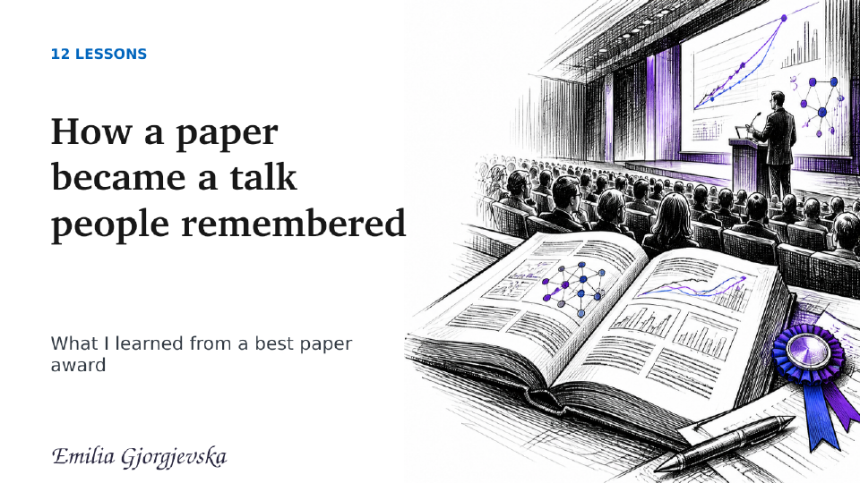
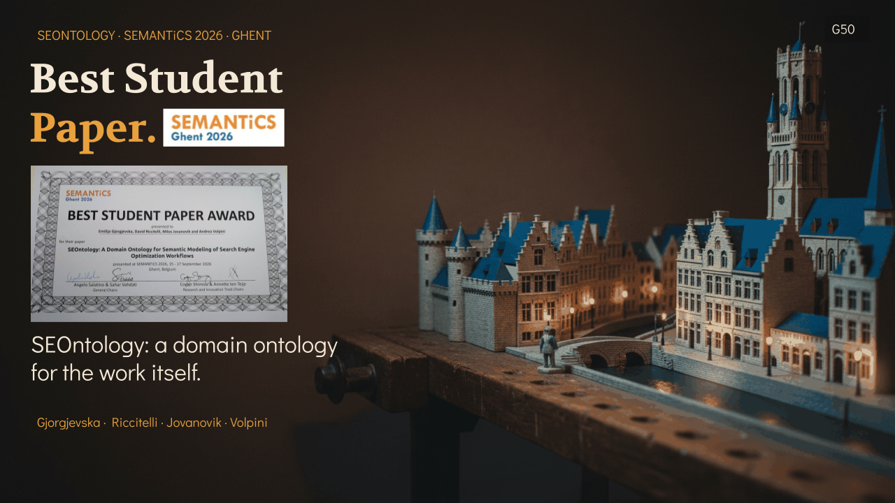

# 12 lessons from a Best Student Paper Award

What helped a research paper become a clearer paper, a stronger talk, and a better conference conversation? I wrote down twelve lessons from my experience, especially for researchers early in their PhD.

**[View the illustrated presentation (PDF)](presentation.pdf)** · **[Read the presentation notes](PRESENTATION_NOTES.md)**

## The award and the paper

Our paper, **“SEOntology: A Domain Ontology for Semantic Modeling of Search Engine Optimization Workflows,”** received the **Best Student Paper Award** at [SEMANTiCS 2026](https://2026-eu.semantics.cc/), the 22nd International Conference on Semantic Systems in Ghent. The paper is by Emilija Gjorgjevska, David Riccitelli, Milos Jovanovik, and Andrea Volpini.

- [SEMANTiCS 2026 award page](https://2026-eu.semantics.cc/page/awards.html)
- [Accepted research papers](https://2026-eu.semantics.cc/page/accepted_research)

These slides share what I learned about revising after reviews, explaining a method visually, learning from critique, preparing a talk, meeting the conference community, and answering questions. They are reflections on one experience, not a guaranteed route to an award.

## Featured at SEOktoberfest 2026

The SEOntology award was also featured at **SEOktoberfest 2026**. This graphic captures that moment:

## About this repository

| File | What it contains |
| --- | --- |
| [`presentation.pdf`](presentation.pdf) | The 13-page illustrated deck, including its cover and twelve lessons |
| [`PRESENTATION_NOTES.md`](PRESENTATION_NOTES.md) | Context and speaking notes for every learning |
| [`assets/`](assets/) | Cover preview and the supplied SEOktoberfest feature graphic |

The illustrations in the deck are conceptual drawings. The SEOktoberfest graphic is included separately as an event feature image.

— Emilija Gjorgjevska
